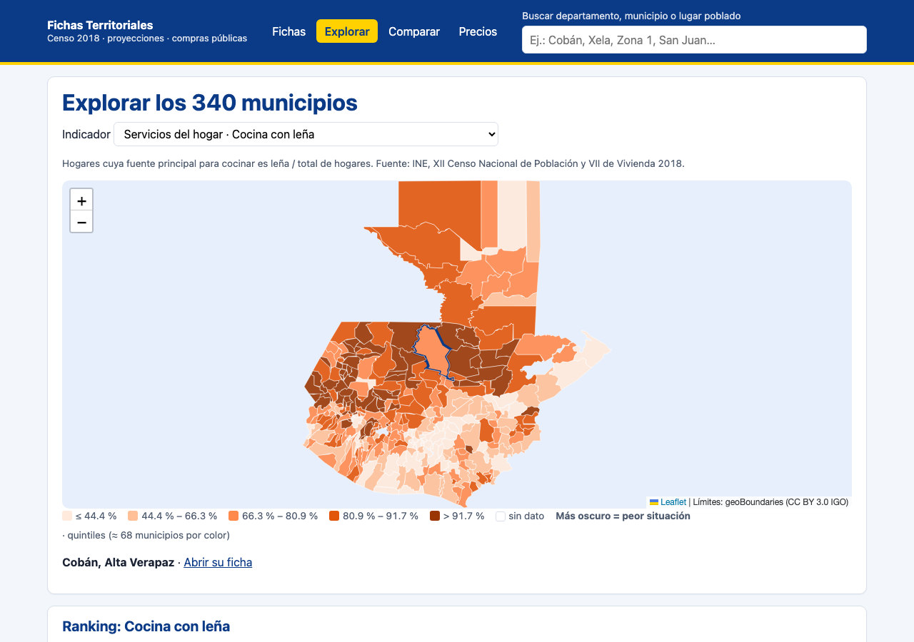
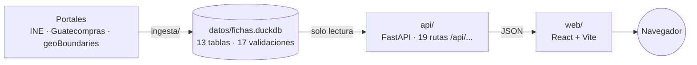

# Fichas Territoriales · INE Guatemala

> **Datatón INE 2026** · Categoría 2: Tecnológica y ciencias de datos
> Equipo **Data de Oriente** · Propuesta 1 del Departamento de Coordinación Regional (DCR)
>
> ▶ **Video demostrativo (2:42):** https://youtu.be/sinnw4udsNA

Herramienta web que produce, en segundos, la **ficha estadística de cualquier departamento,
municipio o lugar poblado de Guatemala** con datos del Censo 2018 y las proyecciones de
población del INE. Además permite consultar **precios de compras públicas** (Guatecompras) junto
al precio de referencia del INE.



## Problema que resuelve

El personal de las **8 coordinaciones regionales y 22 delegaciones departamentales** del INE
atiende solicitudes de información y asiste a reuniones con autoridades locales. Para responder
algo como *"¿cuántos hogares de esta aldea tienen agua entubada?"* hoy hay que descargar varios
libros de Excel del portal, ubicar la hoja correcta entre 20,036 lugares poblados, sumar
categorías y calcular porcentajes a mano. Es lento, cada persona lo calcula a su manera y la
fuente se pierde en la copia.

La herramienta lo resuelve así:

- **Ficha en segundos:** se busca el territorio por nombre (o por apodo, como "Xela") y aparece
  la ficha con 18 indicadores, comparación con el departamento y el país, proyección 2015-2030 y
  los cuadros completos del censo.
- **Una sola fórmula para todos los niveles:** el dato del lugar poblado, del municipio y del
  país se calcula igual, a partir de los conteos publicados por el INE, así que no se contradicen.
- **Lista para la reunión:** la ficha se imprime o se guarda como PDF y los cuadros se descargan
  en CSV con la fuente del INE en la primera línea.
- **Precios de compras públicas:** se busca un producto y se obtienen la mediana, la
  distribución y los precios por departamento, junto al precio de referencia del INE.

## Usuarios

| Usuario | Para qué la usa |
|---|---|
| **Coordinaciones regionales y delegaciones departamentales del INE** | Responder solicitudes de información y preparar reuniones con datos de su territorio, con la fuente citada |
| **Dirección de Precios e Índices de Referencia (DPIR) del INE** | Contrastar precios adjudicados en Guatecompras con los precios de referencia |
| **Municipalidades, COMUDE y consejos de desarrollo** | Conocer el perfil de su municipio y de sus lugares poblados y compararlo con municipios parecidos |
| **Periodistas, estudiantes y público en general** | Consultar datos oficiales sin descargar ni procesar archivos |

**Adopción por el INE:** todo es software libre y sin costo de licencias. Corre en un servidor
propio con un solo comando (`docker compose up`) y no depende de servicios en la nube. Para
actualizarla basta volver a ejecutar la ingesta, y para agregar otro cuadro del censo basta
añadir una línea de código (ver [documentación técnica](docs/documentacion-tecnica.md#7-cómo-extender)).

## Funciones principales

| Sección | Qué ofrece |
|---|---|
| **Fichas** | Ficha del país, departamento, municipio o lugar poblado: indicadores con su definición, comparación con niveles superiores, puesto entre los 340 municipios, "Lo que dicen los datos", municipios parecidos, mapa de lugares poblados, proyección y pirámide de edades, compras de la municipalidad y los 7 cuadros del censo |
| **Explorar** | Mapa de los 340 municipios coloreado por cualquier indicador, ranking por departamento y dispersión entre dos indicadores con su correlación |
| **Comparar** | Dos municipios lado a lado, con la diferencia en cada indicador |
| **Precios** | Estadística de precios unitarios adjudicados (mediana, promedio, moda y atípicos), distribución, precios por departamento y precio de referencia del INE |
| **Rigor y fuentes** | Resultado de las 17 validaciones, archivos fuente con fecha y huella SHA-256 y equivalencias de códigos municipales |

La guía paso a paso está en [docs/manual-de-uso.md](docs/manual-de-uso.md).

## Arquitectura y tecnologías



Cada capa depende solo de la anterior:

1. **Ingesta (`ingesta/`)** lee los archivos del INE, Guatecompras y geoBoundaries, los valida
   y construye una base DuckDB. Si alguna de las 17 validaciones falla, no reemplaza la base
   anterior.
2. **API (`api/`)** abre la base en solo lectura y calcula indicadores, comparaciones,
   correlaciones y estadísticas de precios. Su documentación interactiva queda en `/api/docs`.
3. **Web (`web/`)** es una aplicación de una sola página que solo se comunica con la API.

| Capa | Tecnología | Por qué |
|---|---|---|
| Entorno Python | Python 3.12 + **uv** | Versiones exactas fijadas en `uv.lock` |
| Ingesta | **pandas**, **openpyxl**, **pyarrow**, **shapely** | Lectura de XLSX/CSV con encabezados combinados, Parquet comprimido y cruce espacial |
| Base de datos | **DuckDB** | Base analítica en un solo archivo, sin servidor |
| API | **FastAPI** + **uvicorn** | Validación de parámetros y documentación automática |
| Web | **React 19** + **Vite** | Interfaz rápida y adaptable al celular |
| Mapas y gráficas | **Leaflet**, **Observable Plot** | Mapas sin clave de API; gráficas estadísticas |
| Pruebas | **pytest** (29 pruebas) | Ingesta, base construida y API |
| Despliegue | **Docker Compose** + **nginx** | Dos contenedores y un solo puerto público |

**Servicios de pago o en la nube:** ninguno. La única conexión externa en uso es la de las
teselas de OpenStreetMap (gratuitas) del mapa de lugares poblados. Sin internet, el resto de
la herramienta funciona igual.

El detalle por capa (módulos, modelo de datos, rutas de la API, pruebas y despliegue) está en
[docs/documentacion-tecnica.md](docs/documentacion-tecnica.md).

## Documentación

| Documento | Contenido |
|---|---|
| [Documentación de la aplicación (PDF)](docs/Fichas-Territoriales-Documentacion.pdf) | Documento para el jurado: presentación, arquitectura, instalación, guía de uso con capturas, datos, limitaciones y equipo |
| [Video demostrativo](https://youtu.be/sinnw4udsNA) | 2:42 · problema, equipo, demostración de la herramienta, rigor, tecnología e impacto |
| [Manual de uso](docs/manual-de-uso.md) | Cómo buscar, leer la ficha, imprimir, explorar, comparar y consultar precios |
| [Documentación técnica](docs/documentacion-tecnica.md) | Arquitectura, módulos, base de datos, API, web, pruebas, despliegue y cómo extender |
| [Datos e indicadores](docs/datos-e-indicadores.md) | Fuentes, definición de los 18 indicadores, métodos estadísticos, validaciones y secreto estadístico |
| [Documentación de la API](http://localhost:8090/api/docs) | Swagger interactivo, disponible con la herramienta en marcha |

## Instalación y uso

### Opción A · Docker (recomendada para el jurado)

Requisitos: Git y Docker 24 o superior con Docker Compose.

```bash
git clone https://github.com/Estuardo-Sazo/consulta-territorial-do.git
cd consulta-territorial-do
docker compose up -d --build
```

Abrir **http://localhost:8090**. La documentación de la API queda en
http://localhost:8090/api/docs.

La imagen de la API **construye la base durante el build** a partir de los archivos versionados
en `datos/`. Si una validación falla, el build se detiene. La primera construcción tarda unos
minutos.

### Opción B · Desarrollo local

Requisitos: Python 3.12, [uv](https://docs.astral.sh/uv/) y Node.js 22.

```bash
uv sync                                   # dependencias de Python (uv.lock)
uv run python -m ingesta.cargar           # construye datos/fichas.duckdb y corre las validaciones
uv run pytest -q                          # 29 pruebas
uv run uvicorn api.main:app --port 8010   # API en http://localhost:8010/api/docs
```

En otra terminal:

```bash
cd web
npm ci                                    # dependencias exactas (package-lock.json)
npm run dev                               # web en http://localhost:5180
```

### Uso rápido

1. Escribir un lugar en el buscador (por ejemplo `Cobán`, `Xela` o `Zona 1`) y elegirlo.
2. Revisar la ficha. En cada indicador, **¿Cómo se calcula?** muestra la definición y la fuente.
3. Usar **Imprimir / PDF** para llevarla a una reunión, o **Descargar CSV** en un cuadro.
4. En **Explorar**, elegir un indicador para ver el mapa y el ranking. Al hacer clic en un
   municipio aparece el enlace **Abrir su ficha**.
5. En **Precios**, escribir un producto (por ejemplo `papel bond`) y elegir la unidad de medida.

### Actualizar los datos

Los archivos fuente ya están en el repositorio. Para descargar versiones nuevas:

```bash
uv run python -m ingesta.descargar   # baja las fuentes y actualiza datos/crudos/FUENTES.csv
uv run python -m ingesta.compras     # reduce los zips de Guatecompras a Parquet
uv run python -m ingesta.mapa        # asigna código INE a los polígonos municipales
uv run python -m ingesta.cargar      # reconstruye y valida la base
```

## Conjuntos de datos utilizados

Fuente principal: **Instituto Nacional de Estadística (INE) de Guatemala**, portal
[datos.ine.gob.gt](https://datos.ine.gob.gt). Todos los archivos se descargaron el
**24 de noviembre de 2026**. El registro completo, con URL exacta, tamaño y huella SHA-256 de
cada archivo, está en [`datos/crudos/FUENTES.csv`](datos/crudos/FUENTES.csv) y en el panel
"Rigor y fuentes" de la aplicación.

| Conjunto | Fuente | Licencia | Uso en la herramienta |
|---|---|---|---|
| Censo 2018 · Cuadros A1, A5, A11, A12, B2, B3 y B4 (departamento, municipio y lugar poblado) | INE · [Censo 2018](https://datos.ine.gob.gt/dataset/78019333-d80b-45e8-b694-fb3b8d65e19e) | Términos del portal INE | Indicadores y cuadros de la ficha |
| Censo 2018 · Listado (centroides) de lugares poblados | INE · [Censo 2018](https://datos.ine.gob.gt/dataset/78019333-d80b-45e8-b694-fb3b8d65e19e) | Términos del portal INE | Ubicación de los 20,036 lugares poblados |
| Estimaciones y proyecciones de población por municipio 2015-2030, con su diccionario | INE · [Proyecciones](https://datos.ine.gob.gt/dataset/23bbe8f8-ec9b-49c9-bcca-de78bec4efc0) | Términos del portal INE | Población estimada, crecimiento y pirámide de edades |
| Precios de referencia (junio 2022 y 2 de octubre de 2023) y su diccionario | INE · [Precios de referencia](https://datos.ine.gob.gt/dataset/b247b9ac-e95f-4c32-acd3-fc4bdfb6185a) | ODC-BY | Precio de referencia junto a los precios adjudicados |
| Guatecompras OCDS · procesos publicados de enero a octubre de 2026 (10 archivos mensuales) | [ocds.guatecompras.gt](https://ocds.guatecompras.gt) | CC BY 4.0 | Precios unitarios adjudicados y compras municipales |
| Límites municipales (ADM2, geometría simplificada) | [geoBoundaries](https://www.geoboundaries.org) | CC BY 3.0 IGO | Mapa de los 340 municipios |

Los zips de Guatecompras (356 MB) no se versionan. En `datos/procesados/` se guarda su versión
filtrada en Parquet (≈ 3.6 MB), que es la que usa la base.

La definición de cada indicador y las decisiones sobre los datos están en
[docs/datos-e-indicadores.md](docs/datos-e-indicadores.md).

### Rigor en el uso de los datos

- **Las cifras salen de conteos publicados por el INE.** Los porcentajes se calculan sobre el
  universo de cada cuadro (personas, personas de 7 años o más u hogares). Los valores
  nacionales coinciden con la publicación del Censo 2018: población total 14,901,286,
  alfabetismo 81.5 %, población urbana 53.9 % y alumbrado eléctrico 88.1 %.
- **Las proyecciones se rotulan como proyecciones** y nunca se mezclan con conteos censales.
- **17 validaciones automáticas**, entre ellas: la suma de los lugares poblados debe dar el
  total del municipio, la de los municipios el del departamento, y hombres más mujeres el total.
- **Aviso de pocos casos:** un porcentaje calculado sobre menos de 30 personas u hogares se
  marca como inestable.
- **Indicadores descriptivos sin juicio:** el % de mujeres, el % de población urbana o el de
  pueblo maya no se presentan como logro ni como problema.
- **Correlación no es causalidad:** la dispersión entre indicadores siempre muestra esta
  advertencia.

### Secreto estadístico y seguridad

- Solo se usan **datos agregados publicados**. No se usan microdatos, y la herramienta no
  intenta identificar personas, hogares ni empresas.
- De Guatecompras **no se guardan nombres de proveedores**. Solo se muestran la entidad
  compradora (una institución pública), el producto y el precio.
- El repositorio no contiene credenciales, contraseñas ni llaves de acceso: ninguna fuente las
  requiere.
- La API solo acepta lecturas (`GET`), abre la base en modo de solo lectura y usa consultas
  parametrizadas, lo que evita la inyección SQL.

## Limitaciones

- **El Censo 2018 tiene 8 años.** Los indicadores describen 2018. La población actual es una
  proyección del INE, que solo existe a nivel municipal y no por lugar poblado.
- **Clasificación urbano/rural del censo:** se respeta tal como la publica el INE, aunque algunos
  municipios, como Cobán, aparecen casi 100 % urbanos.
- **Límites municipales no oficiales:** los polígonos son de geoBoundaries, simplificados a unos
  200 m. El código INE se les asigna con los centroides oficiales de los lugares poblados, así
  que el mapa sirve para ubicarse pero no para medir superficies.
- **"Otros lugares poblados"** (códigos que terminan en 999) agrupa lugares pequeños: no es un
  lugar real y la ficha lo indica.
- **Precios de Guatecompras:** son precios **adjudicados**, no de mercado. Solo se calculan
  cuando no hay ambigüedad (procesos de bienes con un renglón y una adjudicación). Abarcan de
  enero a octubre de 2026. La búsqueda es por palabras en una descripción libre y puede mezclar
  productos parecidos.
- **Precios de referencia del INE:** la versión más reciente del portal es del 2 de octubre de
  2023.
- **Municipalidad → municipio:** el cruce se hace por nombre dentro del departamento, con 4
  alias revisados a mano. Las 340 quedan emparejadas, pero un cambio de nombre en Guatecompras
  requeriría revisarlo.
- **Actualización manual:** los datos se actualizan ejecutando la ingesta. No hay descarga
  programada.
- **Sin usuarios ni permisos:** todo lo que muestra es información pública.

## Posibles mejoras

- Actualización programada con la API CKAN de datos.ine.gob.gt, alertando cuando cambie la
  huella de un archivo.
- Más cuadros del Censo 2018 (hogares, empleo, migración, discapacidad): cada uno requiere una
  línea en `ingesta/censo.py`.
- Límites municipales oficiales del INE o del IGN, en lugar de geoBoundaries.
- La **propuesta 2 del DCR**: un tablero de avance de la recopilación de estadísticas continuas
  por delegación, sobre la misma arquitectura.
- Clasificar los productos de Guatecompras (por ejemplo, con el catálogo UNSPSC) para comparar
  precios con más precisión que la búsqueda por palabras.
- Plantilla de PDF institucional con logotipo y numeración de la ficha.
- Despliegue en la intranet del INE para las delegaciones.

## Uso de inteligencia artificial

El equipo usó **Claude (Anthropic), mediante Claude Code**, como asistente de programación para
proponer la estructura del proyecto, escribir y revisar código, pruebas y documentación, e
investigar el formato de las fuentes. Cada integrante revisó e integró desde su propia cuenta
las partes de su rol y puede explicarlas.

La herramienta **no usa IA en ejecución.** El texto "Lo que dicen los datos" se genera con reglas
fijas a partir de los mismos cálculos de la ficha, así que cada cifra se puede rastrear.

## Componentes de terceros y licencias

Cada componente conserva su licencia original.

| Componente | Versión | Licencia |
|---|---|---|
| DuckDB | 2.0.1 | MIT |
| FastAPI | 0.165.0 | MIT |
| uvicorn | 0.54.0 | BSD-3-Clause |
| pandas | 3.1.1 | BSD-3-Clause |
| openpyxl | 3.1.5 | MIT |
| pyarrow | 26.0.1 | Apache-2.0 |
| shapely | 2.2.0 | BSD-3-Clause |
| pytest (desarrollo) | 9.2.0 | MIT |
| httpx2 (desarrollo) | 2.16.2 | BSD-3-Clause |
| uv | 0.13 | MIT / Apache-2.0 |
| React y React DOM | 19.3 | MIT |
| Leaflet | 1.9.4 | BSD-2-Clause |
| Observable Plot | 0.6.19 | ISC |
| Vite y @vitejs/plugin-react (desarrollo) | 8.3 / 6.3 | MIT |
| oxlint (desarrollo) | 1.95 | MIT |
| nginx (imagen Docker) | 1.27 | BSD-2-Clause |
| Teselas de OpenStreetMap | — | Datos ODbL, con atribución en el mapa |

Las licencias de los datos están en la tabla de conjuntos de datos.

## Estructura del repositorio

```
ingesta/            descarga, lectura, validación y carga de las fuentes
datos/crudos/       archivos del INE y geoBoundaries + FUENTES.csv (URL, fecha, SHA-256)
datos/procesados/   Parquet de Guatecompras y GeoJSON de municipios (derivados)
api/                API FastAPI: lógica en api/*.py y rutas HTTP en api/rutas/
web/                interfaz React + Vite, con su Dockerfile y nginx.conf
tests/              pruebas de ingesta, base y API
docs/               documentación técnica, de datos y de uso
```

## Equipo

| Rol | Integrante | Carpetas |
|---|---|---|
| 1 · Datos e ingesta | Jaime Estuardo Sazo | `ingesta/`, `datos/` |
| 2 · API y análisis | Miguel Angel Sazo | `api/`, `docker-compose.yml` |
| 3 · Interfaz web | Roberto Augusto Carrillo | `web/` |

## Fuente y licencia

**Fuente de los datos:** Instituto Nacional de Estadística (INE) de Guatemala: XII Censo
Nacional de Población y VII de Vivienda 2018, Estimaciones y proyecciones de población
2015-2030 y Precios de referencia. Complementado con Guatecompras (OCDS) y geoBoundaries.

Los autores conservan el reconocimiento de autoría y otorgan al INE una licencia no exclusiva,
gratuita, perpetua e irrevocable para usar, reproducir, modificar, adaptar y distribuir la
herramienta y su documentación con fines institucionales, según las bases del Datatón INE 2026.
