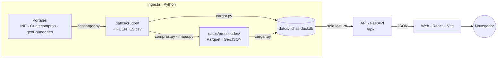

# Documentación técnica

Cómo está construida la herramienta: capas, módulos, base de datos, API, web, pruebas y
despliegue. Para usarla, ver el [manual de uso](manual-de-uso.md). Para las definiciones de las
cifras, ver [datos e indicadores](datos-e-indicadores.md).

## 1. Arquitectura



| Regla | Consecuencia |
|---|---|
| Solo la ingesta escribe datos | Si una validación falla, la base anterior no se reemplaza (escritura atómica con `rename`) |
| La API abre la base en solo lectura | No hay forma de modificar datos desde la web |
| La web solo conoce la API | Se puede cambiar la base sin tocar la interfaz |

## 2. Ingesta (`ingesta/`)

Orden de ejecución:

```bash
uv run python -m ingesta.descargar   # 1. fuentes nuevas (actualiza FUENTES.csv con SHA-256)
uv run python -m ingesta.compras     # 2. mes nuevo de Guatecompras → Parquet
uv run python -m ingesta.mapa        # 3. cambio de límites municipales → GeoJSON
uv run python -m ingesta.cargar      # 4. siempre: construye y valida la base
```

Los pasos 1 a 3 generan archivos versionados, así que para levantar la herramienta solo hace
falta el paso 4.

| Módulo | Responsabilidad |
|---|---|
| `comun.py` | Rutas del proyecto y `normalizar()` (quita tildes y signos para cruzar nombres) |
| `descargar.py` | Catálogo de 24 fuentes. Descarga con reintentos, revisa la firma del archivo (detecta páginas de error HTML) y registra URL, fecha, bytes y SHA-256 |
| `cuadros.py` | Lector genérico de los cuadros del Censo 2018: reconstruye los encabezados combinados, detecta el nivel por las columnas de identificación y devuelve **formato largo** |
| `censo.py` | Lista de los 7 cuadros cargados. Agregar uno es una línea |
| `territorio.py` | 22 departamentos, 340 municipios y 20,036 lugares poblados con coordenadas. Marca los agrupados (`...999`) |
| `equivalencias.py` | Códigos del censo ↔ códigos de las proyecciones, por nombre dentro del departamento. Exige los 340 |
| `proyecciones.py` | Población 2015-2030 por municipio, sexo y edad, en código del censo. Repara edades vacías por posición |
| `precios_ref.py` | Une las versiones 2022 y 2023 de los precios de referencia y elige el precio de fecha más reciente |
| `guatecompras.py` | Lee los CSV de OCDS dentro de los zips y calcula el precio unitario solo cuando no hay ambigüedad |
| `municipalidades.py` | Empareja cada municipalidad compradora con su municipio (exacto → prefijo/sufijo → aproximado), dentro del departamento |
| `compras.py` | Filtra bienes, asigna municipio y escribe 3 Parquet comprimidos con zstd |
| `mapa.py` | Asigna código INE a los polígonos de geoBoundaries contando qué centroides caen en cada uno (`shapely.STRtree`) y simplifica la geometría |
| `validaciones.py` | 17 chequeos SQL. Cada uno cuenta problemas y 0 significa aprobado |
| `cargar.py` | Escribe todo en `fichas.duckdb.tmp`, crea índices, valida y solo entonces renombra a `fichas.duckdb` |

### Modelo de datos (`datos/fichas.duckdb`, ≈ 46 MB)

| Tabla | Filas | Contenido |
|---|---:|---|
| `departamentos` | 22 | Código y nombre |
| `municipios` | 340 | Código, departamento y nombre |
| `lugares_poblados` | 20,036 | Código, nombre, coordenadas y `es_agrupado` |
| `cuadros` | 7 | Título, tema, unidad, universo y notas de cada cuadro |
| `valores` | 1,856,309 | Todos los cuadros en formato largo: `nivel, codigo, cuadro, grupo, categoria, orden, valor` |
| `equivalencias_municipio` | 340 | Código del censo ↔ código de las proyecciones |
| `proyecciones` | 1,158,720 | Población por municipio, año, sexo y edad |
| `precios_referencia` | 4,993 | Precios del INE con precio y fecha vigentes |
| `precios_guatecompras` | 157,044 | Renglones de bienes con precio unitario |
| `compras_municipales` | 16,964 | Procesos de las 340 municipalidades |
| `equivalencias_municipalidad` | 340 | Comprador de Guatecompras → municipio y método de emparejamiento |
| `fuentes` | 24 | URL, licencia, fecha y SHA-256 |
| `validaciones` | 17 | Resultado de cada chequeo |

**Por qué formato largo:** una sola tabla `valores` guarda los 7 cuadros, así que la API puede
mostrar cualquiera sin conocer sus columnas y agregar un cuadro no cambia el esquema.

## 3. API (`api/`)

La lógica (`api/*.py`) está separada de la capa HTTP (`api/rutas/*.py`), de modo que los
cálculos se pueden probar sin servidor.

| Módulo | Responsabilidad |
|---|---|
| `db.py` | Conexión DuckDB en solo lectura, abierta una vez (con candado) y un cursor por consulta. Parámetros siempre con `?`, lo que evita la inyección SQL |
| `indicadores.py` | Catálogo de los 18 indicadores: definición, fuente, unidad, **sentido** y fórmula |
| `calculo.py` | `bases()` trae los conteos y `calcular()` aplica las fórmulas. Es la misma función para los 4 niveles, con caché en memoria |
| `analisis.py` | Puesto, percentil, dónde destaca y retos, valores z, municipios parecidos y correlación de Pearson |
| `texto.py` | "Lo que dicen los datos" con reglas fijas |
| `territorio.py` | Búsqueda sin tildes con alias populares y jerarquía por división del código |
| `precios.py` | Mediana, promedio, moda, cuartiles, atípicos (Tukey) y búsqueda de referencias INE |
| `main.py` | Aplicación FastAPI, CORS solo `GET` y prefijo `/api` |

### Rutas

Documentación interactiva (Swagger) en **`/api/docs`**.

| Ruta | Devuelve |
|---|---|
| `GET /api/salud` | Estado (healthcheck de Docker) |
| `GET /api/buscar?q=` | Departamentos, municipios y lugares que coinciden |
| `GET /api/departamentos` | 22 departamentos con población |
| `GET /api/departamentos/{codigo}/municipios` | Municipios del departamento |
| `GET /api/municipios/{codigo}/lugares` | Lugares poblados con población, hogares, área y coordenadas |
| `GET /api/ficha/{nivel}/{codigo}` | Ficha completa: indicadores, comparación, posición, destaca/retos, parecidos y texto |
| `GET /api/cuadros` | Catálogo de los 7 cuadros |
| `GET /api/cuadros/{cuadro}/{nivel}/{codigo}` | Un cuadro con % local y % nacional |
| `GET /api/proyecciones/{nivel}/{codigo}?anio=` | Serie 2015-2030 y pirámide de edades |
| `GET /api/calidad` | Validaciones, fuentes y equivalencias |
| `GET /api/indicadores` | Catálogo de indicadores |
| `GET /api/mapa/municipios.geojson` | Polígonos de los 340 municipios |
| `GET /api/mapa/{clave}` | Valor del indicador en los 340 municipios |
| `GET /api/ranking/{clave}?departamento=` | Municipios ordenados |
| `GET /api/dispersion?x=&y=` | Puntos, *r* de Pearson y advertencia de causalidad |
| `GET /api/comparar?a=&b=` | Dos municipios lado a lado |
| `GET /api/precios?q=&unidad=&departamento=` | Estadística, distribución, renglones, departamentos y referencias INE |
| `GET /api/precios/sugerencias?q=` | Autocompletar de productos |
| `GET /api/compras/municipio/{codigo}` | Compras de la municipalidad |

`nivel` acepta solo `pais`, `departamento`, `municipio` o `lugar_poblado`: cualquier otro valor
responde **422**. Un código inexistente responde **404**.

## 4. Web (`web/`)

Aplicación de una sola página con React 19 y Vite.

| Parte | Archivos | Detalle |
|---|---|---|
| Núcleo | `App.jsx`, `ruta.js`, `api.js`, `formato.js`, `paleta.js` | Navegación por hash (`#/ficha/municipio/1601`), `fetch` con caché en memoria, formato `es-GT` y paleta institucional del INE |
| Páginas | `paginas/Explorar.jsx`, `Comparar.jsx`, `Precios.jsx` y `componentes/Ficha.jsx` | El estado de cada página vive en la URL, así que se puede compartir |
| Ficha | `Hallazgos`, `Indicadores`, `Parecidos`, `Subterritorios`, `MapaLugares`, `Proyecciones`, `ComprasMunicipio`, `TablaCuadro` | Una sección por componente |
| Gráficas | `Grafica.jsx` | Envoltorio de Observable Plot que mide el ancho con `ResizeObserver` |
| Mapas | `MapaCoropletico.jsx`, `MapaLugares.jsx` | Leaflet. El coroplético no usa teselas, así que funciona sin internet |
| Transparencia | `Rigor.jsx` | Validaciones, fuentes y equivalencias |

Decisiones de diseño:

- **Honestidad visual:** ejes desde cero en las proyecciones, círculos con área proporcional a
  la población, quintiles en el mapa y colores que no juzgan a los indicadores descriptivos.
- **Seguridad:** los tooltips se arman con `textContent`, no con `innerHTML`.
- **Respuestas fuera de orden:** si se cambia de ficha antes de que llegue la respuesta anterior,
  esa respuesta se descarta.
- **Impresión:** `@media print` oculta la navegación y los botones y evita cortar tarjetas.
- **CSV:** la primera línea cita la fuente del INE e incluye BOM para que Excel lea las tildes.

## 5. Pruebas

```bash
uv run pytest -q   # 29 pruebas
```

| Archivo | Qué prueba |
|---|---|
| `tests/test_ingesta.py` | Funciones puras con datos pequeños: normalización, encabezados combinados, números y fechas de precios, emparejamiento de municipalidades |
| `tests/test_base.py` | La base construida: validaciones aprobadas, 22 departamentos y 340 municipios, equivalencia de Mixco y polígonos sin repetir |
| `tests/test_api.py` | Rutas con `TestClient`: búsqueda, valores nacionales iguales a la publicación del censo, fichas, errores 404/422, mapa, dispersión, comparación, proyecciones, precios y calidad |

Para la web: `cd web && npm run lint && npm run build`.

## 6. Despliegue

```bash
docker compose up -d --build   # http://localhost:8090
```

| Contenedor | Imagen | Qué hace |
|---|---|---|
| `api` | `python:3.12-slim` + uv | Instala dependencias desde `uv.lock`, **construye la base durante el build** (si falla una validación, falla el build) y sirve FastAPI en el puerto 8000 interno |
| `web` | `node:22-alpine` → `nginx:1.27-alpine` | Compila la web en una etapa y la sirve con nginx en otra. Reenvía `/api/` al contenedor `api` |

Solo se publica el puerto **8090**. La API queda en la red interna de Docker y el navegador
habla con un solo origen, sin CORS. La web espera a que el healthcheck de la API
(`/api/salud`) esté en verde.

| Variable | Uso | Valor por omisión |
|---|---|---|
| `FICHAS_DB` | Ruta de la base | `datos/fichas.duckdb` |
| `FICHAS_GEOJSON` | Ruta de los polígonos | `datos/procesados/municipios.geojson` |
| `CORS_ORIGENES` | Orígenes permitidos en desarrollo | `http://localhost:5180` |

No se requieren credenciales ni llaves de acceso.

## 7. Cómo extender

| Para… | Hacer |
|---|---|
| Agregar un cuadro del censo | Añadir su URL en `ingesta/descargar.py` y una línea en `ingesta/censo.py`, y ejecutar la ingesta |
| Agregar un indicador | Añadir un `Indicador` en `api/indicadores.py`. La ficha, el mapa, el ranking y la comparación lo toman solos |
| Agregar un mes de Guatecompras | Añadirlo en `descargar.py` y ejecutar `compras` y `cargar` |
| Agregar un alias de búsqueda | Editar `ALIAS` en `api/territorio.py` |
